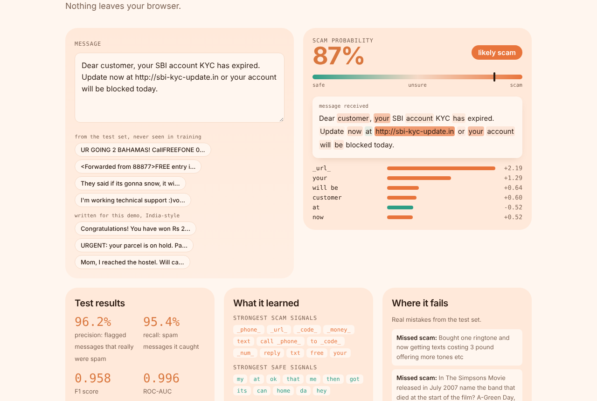

# Scam SMS Detector

**Live demo: https://deeku46.github.io/scam-sms-detector/**

Paste any text message and an NLP model scores it as you type, highlighting the words that pushed it towards scam or safe. It runs in the browser, and the repo also includes a FastAPI service so a WhatsApp or Telegram bot can call the same model.



## Results (1,034 held-out messages)

| Metric | Score |
| --- | --- |
| Precision | **96.2%** |
| Recall | **95.4%** |
| F1 | **0.958** |
| ROC-AUC | **0.996** |

Confusion matrix: 898 genuine messages correctly passed, 5 false alarms, 6 missed spam, 125 spam caught.

5-fold cross-validation F1 on the training set:

| Model | F1 |
| --- | --- |
| Multinomial Naive Bayes | 0.959 |
| Linear SVM | 0.958 |
| **Logistic regression (shipped)** | 0.957 |

All three are equally accurate. Logistic regression is the one shipped because each word has a readable weight, which is what makes the highlighting possible.

## How it works

1. **Normalise** (`training/normalise.py`): links become `_url_`, phone numbers `_phone_`, amounts like Rs 5,000 or £100 become `_money_`, and short codes become `_code_`. The model learns the pattern "call `_phone_` to claim" instead of memorising one number.
2. **TF-IDF** over words and word pairs (10,063 features, sublinear term frequency).
3. **Logistic regression** with balanced class weights.
4. **Export**: vocabulary, IDF values and weights go to `model.js`. The browser re-implements normalisation, TF-IDF and scoring, and matches the Python model to 5 decimal places on 800 messages.

It also flags India-style scams it never trained on, such as KYC expiry, lottery and parcel redelivery fees.

## Known limits

- The data is UK SMS from around 2012. Genuine OTP and bank-alert messages are rare in it, so they can score as borderline.
- The page lists real test-set mistakes, both missed scams and false alarms.

## Use it as an API

```bash
pip install -r requirements.txt
uvicorn api:app --reload
curl -X POST localhost:8000/check -H "Content-Type: application/json" \
     -d '{"text": "You won Rs 50,000. Call 9876543210 to claim"}'
# {"scam_probability": 0.9998, "is_scam": true,
#  "top_signals": [{"term": "_phone_", "weight": 2.718}, {"term": "_money_", "weight": 1.887}, ...]}
```

## Retrain

```bash
cd training && python train.py   # writes ../model.js and ../model.joblib
```

## Data

[SMS Spam Collection v1](https://archive.ics.uci.edu/dataset/228/sms+spam+collection) by Tiago A. Almeida and José María Gómez Hidalgo (UCI Machine Learning Repository, CC BY 4.0). It has 5,574 messages, 5,169 after removing duplicates, of which 653 are spam.

## Stack

Python · scikit-learn · FastAPI · vanilla JavaScript

Built by [Deekshith P](https://deeku46.github.io/) · MIT licence
